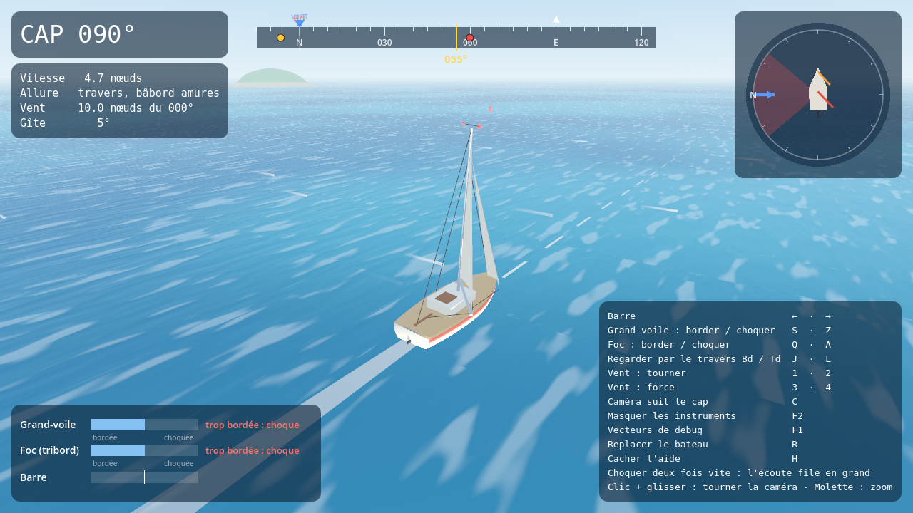
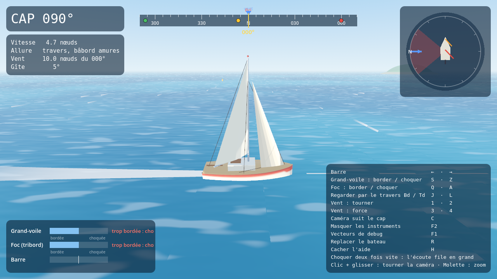

# Sailing Adventures

Petite aventure à la voile, semi-réaliste, en 3D mignonne. Prototype **P0.1** : un bac à
sable pour sentir la manœuvre d'un petit quillard (grand-voile et foc).



Le jeu vise à terme une navigation **au ressenti**. L'interface chiffrée actuelle sert
au développement ; F2 la masque.

- Vision : [docs/vision.md](docs/vision.md)
- Modèle physique : [docs/modele-voile.md](docs/modele-voile.md)
- Décisions techniques : [docs/decisions.md](docs/decisions.md)
- Journal de développement (fait, mesuré, limites, suite) : [docs/journal.md](docs/journal.md)

## Lancer le jeu

1. Installer [Godot 4.7](https://godotengine.org/download/linux/) (version standard, pas
   .NET). Le binaire Linux est autonome : il suffit de le décompresser et de le placer dans
   le PATH, par exemple
   `sudo install -m 755 Godot_v4.7.2-stable_linux.x86_64 /usr/local/bin/godot`.
2. Lancer le jeu depuis la racine du dépôt :
   ```bash
   godot --path game
   ```
   Avec les vecteurs de forces affichés : `godot --path game -- --debug`.
   Ou ouvrir `game/project.godot` dans l'éditeur (`godot -e --path game`), puis **F5**.

Au premier lancement, Godot importe le projet (quelques secondes) et crée `game/.godot/`,
qui n'est pas versionné.

## Commandes

Les touches sont des positions physiques : elles marchent en AZERTY comme en QWERTY.
L'aide du jeu (H) affiche les noms de ton clavier.

| Action | AZERTY |
|---|---|
| Barre | ← / → |
| Grand-voile : border / choquer | S / Z |
| Foc : border / choquer | Q / A |
| Choquer en grand | deux appuis rapides sur « choquer » |
| Regarder par le travers bâbord / tribord | J / L (même touche pour revenir) |
| Vent : tourner / force | 1 · 2 / 3 · 4 |
| Masquer les instruments | F2 |
| Vecteurs de debug | F1 |
| Caméra suit le cap | C |
| Replacer le bateau | R |

## Exercices du bac à sable

Le vent vient du nord, à 10 nœuds. Le bateau part au travers, bâbord amures.

1. **Régler ses voiles** : choque jusqu'à ce que la voile faseye, puis borde juste assez
   (« bien réglée » sur les penons).
2. **Remonter au vent** vers la bouée jaune au nord. Sous 30° du vent environ (secteur
   rouge de la rose), le bateau n'avance plus.
3. **Savoir quand virer** : passe en vue de travers (J ou L, du côté de la bouée). Le
   compas de relèvement montre si la bouée est devant ou derrière le travers. Quand elle
   y arrive, vire.
4. **Virer de bord** avec de l'élan : le foc passe tout seul. Sans vitesse, le bateau
   reste bout au vent et la barre ne répond plus.
5. **Empanner** au vent arrière : borde la grand-voile avant, sinon la bôme passe d'un coup.
6. **Choquer en grand** en urgence (deux appuis rapides) quand le bateau gîte trop.
7. **Naviguer au ressenti** : F2, puis lis le vent avec les lignes de vent, la girouette
   et la forme des voiles.
8. **Changer le vent** : 1 et 2 le font tourner, 3 et 4 changent sa force.

La caméra se tourne en cliquant-glissant et se zoome à la molette ; C la détache du cap.



## Retours utiles après une partie

Les sensations, en termes de marin : le bateau tourne-t-il trop mollement ou trop vite ?
La vitesse et la gîte sont-elles crédibles ? Les écoutes vont-elles trop vite ou trop
lentement ? Remonte-t-il trop près du vent ? Manque-t-il une information à l'écran ?
En cas d'erreur dans le terminal, la copier telle quelle.

## Outils

```bash
tools/test.sh          # tests de la simulation
tools/smoke.sh         # lance la scène sans interface et vérifie qu'il n'y a pas d'erreur
tools/polar.sh         # polaire de vitesse -> docs/img/polaire.png
tools/screenshot.sh    # capture d'écran -> docs/img/capture.png
```

Les scripts utilisent `godot` du PATH, ou la variable `GODOT=/chemin/vers/godot`.
